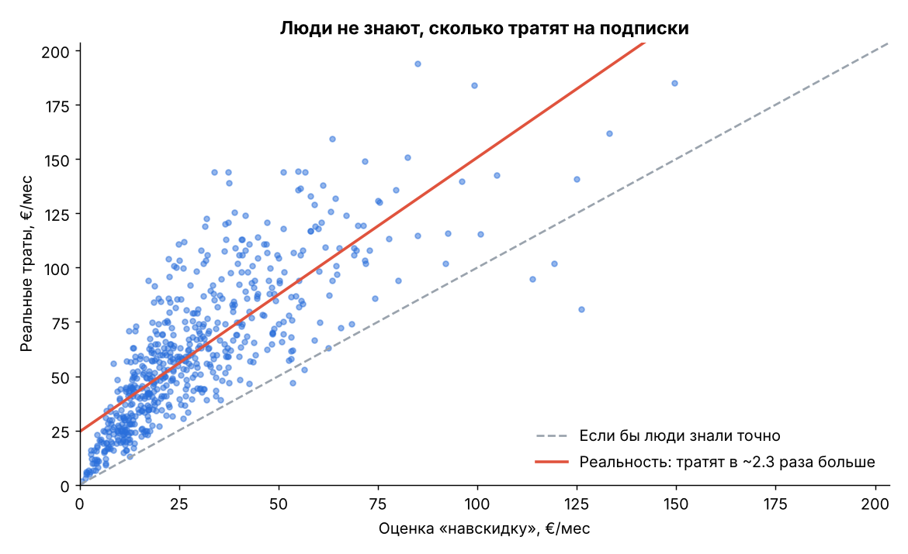
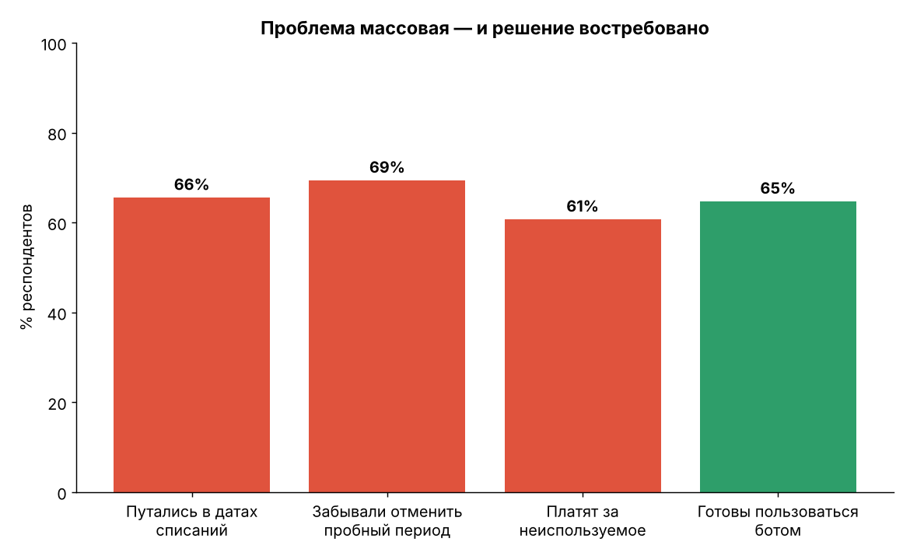
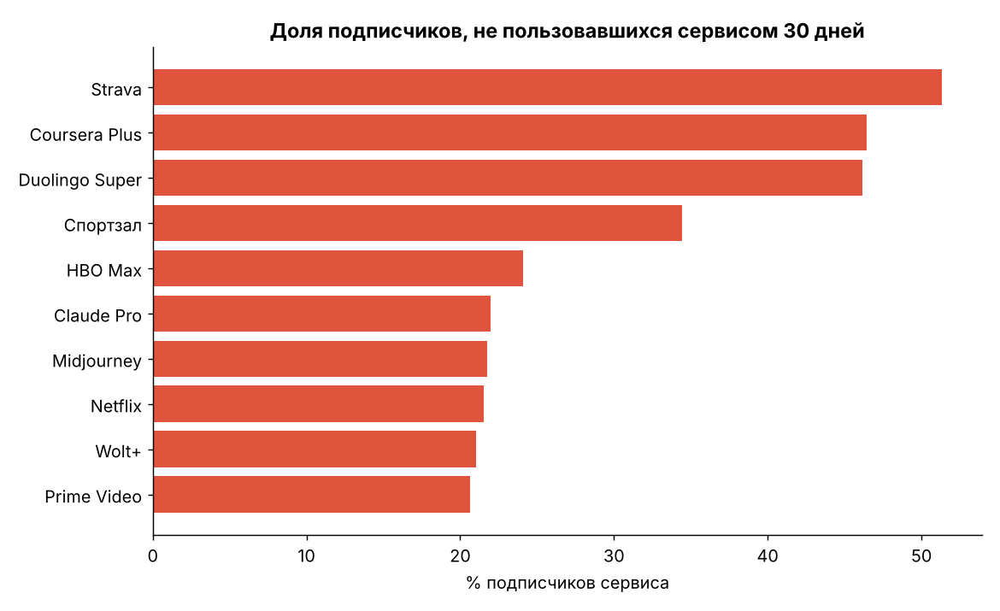
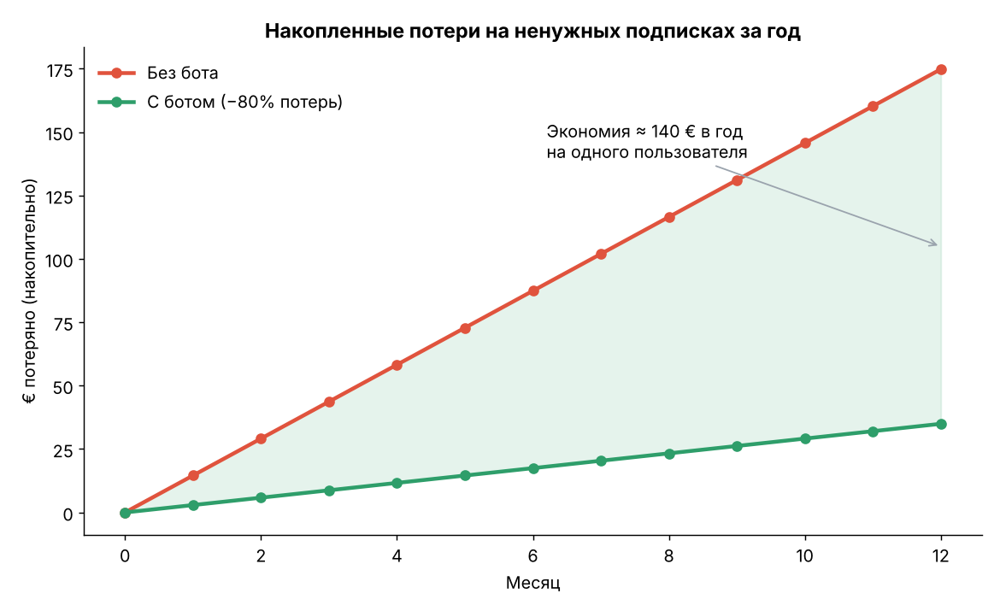

# SubKiller — Telegram-бот для учёта подписок

**SubKiller** — Telegram-бот, который собирает все платные подписки пользователя в одном месте, заранее напоминает о списаниях и окончании пробных периодов и показывает, сколько денег в сумме уходит на подписки.

> Университетский проект. Тема: «Разработка Telegram-бота для учёта и контроля регулярных подписочных платежей».

## Зачем это нужно

Я часто забываю, когда списывается ежемесячный платёж за ту или иную подписку. Когда подписок несколько, уследить за всеми датами ещё сложнее. Бывает и так, что подписка давно подключена, но я ей уже не пользуюсь, а деньги продолжают списываться. SubKiller решает эту проблему: все подписки хранятся в одном боте, а он сам напоминает о платежах и показывает, сколько на них уходит.

## Анализ данных

Чтобы проверить, что проблема касается не только меня, я сгенерировал данные опроса 600 человек (студенты и молодые работающие) и проанализировал их с помощью **numpy**, **pandas** и **matplotlib**.

Данные синтетические, но их параметры откалиброваны по реальным исследованиям: C+R Research (2022), Self Financial (2025–2026), CNET/YouGov (2025).

### Основные выводы

| Показатель | Значение |
|---|---|
| Подписок у одного человека в среднем | 5,8 |
| Траты на подписки «навскидку» | ≈ 29 € в месяц |
| Реальные траты | ≈ 61 € в месяц (в 2,3 раза больше) |
| Платят за подписку, которой не пользовались 30 дней | 61% |
| Потери на неиспользуемых подписках | ≈ 151 € в год на человека |
| Хотя бы раз не отменили пробный период | 69% |
| Путались в датах списаний | 66% |
| Готовы пользоваться ботом (оценка 4–5 из 5) | 65% |
| Возможная экономия с ботом | ≈ 140 € в год на пользователя |

Интерес к боту растёт вместе с числом подписок (коэффициент корреляции r = 0,51). Чаще всего бросают подписки на обучение (Coursera, Duolingo) и спорт.

### Графики

| | |
|---|---|
|  |  |
|  |  |

Остальные графики лежат в [`analysis/charts`](analysis/charts).

### Запуск анализа

```bash
pip install -r requirements.txt
cd analysis
python generate_data.py   # создаёт respondents.csv и subscriptions.csv
python analysis.py        # печатает метрики и сохраняет графики в charts/
```

## Telegram-бот

🚧 *В разработке.*

### Возможности

- Добавление подписки: сервис, цена, валюта, период, дата следующего списания
- Список подписок и подсчёт трат в месяц и в год, разбивка по категориям
- Напоминания за 1–3 дня до списания и до конца пробного периода
- Распознавание подписки из пересланного письма или уведомления о платеже
- Отметка «не пользуюсь», чтобы находить подписки, которые стоит отменить

### Команды

| Команда | Что делает |
|---|---|
| `/start` | Приветствие и краткая инструкция |
| `/add` | Добавить подписку |
| `/list` | Показать все подписки |
| `/total` | Сколько уходит в месяц и в год |
| `/remove` | Удалить подписку |

### Стек

- Python 3.11+
- [aiogram 3](https://docs.aiogram.dev/) — работа с Telegram Bot API
- SQLite + SQLAlchemy — хранение данных
- APScheduler — напоминания по расписанию

### Запуск бота

```bash
pip install -r requirements.txt
# создайте файл .env и укажите токен от @BotFather:
# BOT_TOKEN=ваш_токен
python bot/main.py
```

Бот доступен в Telegram: *ссылка появится после размещения на хостинге*.

## Структура репозитория

```
subkiller/
├── analysis/
│   ├── generate_data.py     # генерация датасета
│   ├── analysis.py          # анализ и построение графиков
│   ├── respondents.csv      # данные опроса
│   ├── subscriptions.csv    # подписки респондентов
│   └── charts/              # графики для защиты
├── bot/                     # код Telegram-бота
├── requirements.txt
└── README.md
```

## Планы на развитие

- Распознавание чеков по фото (OCR)
- Подключение почты (Gmail API) для автоматического поиска писем о подписках
- Конвертация валют по актуальному курсу
- Веб-панель на Flask с графиками расходов

## Источники

- [C+R Research: люди недооценивают траты на подписки](https://www.cnbc.com/2022/09/06/consumers-underestimate-monthly-subscription-costs-by-at-least-100.html)
- [Self Financial: The Cost of Unused Subscriptions](https://self.inc/info/cost-of-unused-paid-subscriptions)
- [Subscription Spending Statistics (2026)](https://walnutinvest.com/stats/subscription-spending-statistics)
